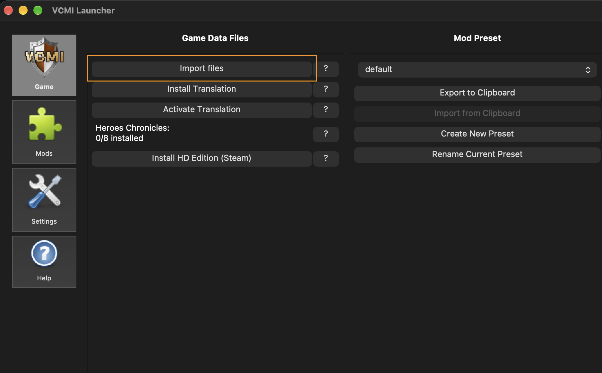

# Mistral Le Chonk plays Heroes of Might and Magic III

This repository adds an MCP server into game engine (C++) code and game harness (Typescript) that lets a Mistral model play the game.

The agent walks the adventure map, picks up resources, visits objects, fights battles (attack, wait, defend), answers dialogs, and ends the day when movement runs out.

https://github.com/user-attachments/assets/77dab1f3-a235-43d6-a211-92ae925f6e4b

# Set up and run

Prerequisites:

1. You must own Heroes of Might and Magic III and have the original game files. On [GOG the game is about 3 EUR](https://www.gog.com/en/game/heroes_of_might_and_magic_3_complete_edition).
2. This fork changes the engine, so you have to compile VCMI from this repository.
3. A [Mistral API key](https://console.mistral.ai/).
4. [Node.js](https://nodejs.org/) for the game agent.

## 1. Engine and game files

This project is based on [VCMI](https://vcmi.eu/), an open-source Heroes of Might and Magic III engine. It does not include the full game: you still need the original data files (`Data`, `Maps`, `Mp3`).

The easiest source is a [GOG game](https://www.gog.com/en/game/heroes_of_might_and_magic_3_complete_edition) purchase. Download the Windows offline installer (`.exe` plus matching `.bin`) from their website:


After you compile and launch VCMI, the launcher asks where those files are. Point it at the installer (or at an existing Heroes III install).



More info:
- [Windows](players/Installation_Windows.md)
- [macOS](players/Installation_macOS.md)
- [Linux](players/Installation_Linux.md)
- [Android](players/Installation_Android.md)
- [iOS](players/Installation_iOS.md)

## 2. Compile the engine

- [Building VCMI for Android](developers/Building_Android.md)
- [Building VCMI for iOS](developers/Building_iOS.md)
- [Building VCMI for Linux](developers/Building_Linux.md)
- [Building VCMI for macOS](developers/Building_macOS.md)
- [Building VCMI for Windows](developers/Building_Windows.md)
- [Conan](developers/Conan.md)

Start **vcmiclient**. While the game window is open, the MCP server listens on `http://127.0.0.1:47321/mcp`.

## 2.1 Alternative to compiling
As alternative to compiling code would be downloading and running binary files from the release run:

https://github.com/andreinwald/heroes-3-mcp/actions/runs/40203187558/attempts/1


## 3. Game agent and API key

The agent lives in [`mcp_client/`](../mcp_client). Copy `.env.example` to `.env` and put your Mistral API key in `MISTRAL_API_KEY`.

```shell
cd mcp_client
cp .env.example .env
npm install
npm start
```

Optional: `npm start -- "scout north and pick up gold"` suggests the first action; after that the model keeps playing on its own.

# MCP in the game engine

While **vcmiclient** is open, an MCP HTTP server listens on `http://127.0.0.1:47321/mcp`. Tool calls run on the GUI thread. The model can observe the map, a hero, a town, or a battle, then move, attack, wait, defend, answer a dialog, or end the turn.

Code lives in [`client/mcp/`](../client/mcp):

- [`McpServer.cpp`](../client/mcp/McpServer.cpp) / [`McpServer.h`](../client/mcp/McpServer.h) — HTTP MCP endpoint, tool catalog, request dispatch. Started from [`client/GameEngine.cpp`](../client/GameEngine.cpp).
- [`GameStateSnapshot.cpp`](../client/mcp/GameStateSnapshot.cpp) / [`GameStateSnapshot.h`](../client/mcp/GameStateSnapshot.h) — `get_state`, `get_map`, `get_hero`, `get_town`, `get_battle` (visible state as text).
- [`GameActions.cpp`](../client/mcp/GameActions.cpp) / [`GameActions.h`](../client/mcp/GameActions.h) — `move_hero`, `attack`, `wait`, `defend`, `end_turn`; legal battle targets.
- [`McpDialogs.cpp`](../client/mcp/McpDialogs.cpp) / [`McpDialogs.h`](../client/mcp/McpDialogs.h) — blocking pop-ups in state, and `answer`.
- [`McpBattleWaiter.cpp`](../client/mcp/McpBattleWaiter.cpp) / [`McpBattleWaiter.h`](../client/mcp/McpBattleWaiter.h) — wait off the GUI thread until the next battle decision is ready.

# Game harness

[`mcp_client/`](../mcp_client) is a TypeScript loop: connect to the game MCP, send state to Mistral, run the tool the model picks, repeat. It does not embed the engine.

- [`src/agent.ts`](../mcp_client/src/agent.ts) — main loop, Mistral calls, tool execution (`mistral-large-4`).
- [`src/gameMcp.ts`](../mcp_client/src/gameMcp.ts) — MCP client over HTTP to `127.0.0.1:47321`.
- [`src/logger.ts`](../mcp_client/src/logger.ts) — JSONL run logs in `mcp_client/logs/`.
- [`system.md`](../mcp_client/system.md) — system prompt (how to play; tools come from the engine at runtime).
- [`.env.example`](../mcp_client/.env.example) — `MISTRAL_API_KEY` template. Copy to `.env`.
- [`package.json`](../mcp_client/package.json) — `npm start` runs the agent.
